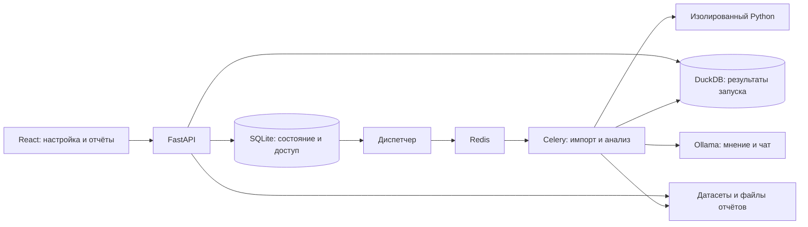

# Баланс · Система анализа изменений

**Команда:** Доброта

**Кейс:** «Система анализа измерений»

**Задача:** сравнить ответы двух версий системы принятия решений, найти изменения и представить их в интерактивном отчёте.

**Участники:**

- Великанов Михаил
- Савинов Павел
- Петров Тимур

[Описание](#1-описание-решения) · [Структура](#2-структура-репозитория) · [Технологии](#3-используемые-технологии) · [Данные](#4-данные) · [Архитектура](#5-архитектура-и-подход) · [Результаты](#6-эксперименты-и-результаты) · [Запуск](#7-инструкция-по-запуску) · [Ограничения](#8-ограничения-и-дальнейшее-развитие) · [Скриншоты](#скриншоты-интерфейса)

## 1. Описание решения

«Баланс» сопоставляет ответы **до изменения стратегии (BEFORE / MASTER)** и **после (AFTER / BETA)** по идентификатору заявки. Система показывает, какие атрибуты и решения изменились, рассчитывает показатели, выполняет Python-проверки и позволяет перейти от общей статистики к конкретной заявке и её исходным ответам.

Основная идея — отделить настраиваемую логику анализа от хранения данных, очереди и интерфейса. Пользователь задаёт четыре этапа обработки через конфигурацию и Python-процедуры, а каждый запуск сохраняет использованные версии кода и параметров.

Реализовано:

- **Загрузка данных:** ZIP с множеством файлов, пара CSV/XML «до» и «после» либо один общий файл; проверка структуры, парности и ограничений размера.
- **Единая настройка анализа:** выбор датасета, нормализация, сравнение, подготовка отчёта и автоматические проверки. Для этапов доступны стандартная процедура, библиотека, загрузка `.py`, редактор CodeMirror и параметры; конфигурацию можно сохранить как шаблон.
- **Контроль кода:** документация контрактов, предварительная проверка сигнатур и структуры, изолированное исполнение пользовательского Python, сохранение версий.
- **Отчёты:** обзор различий, доля одобренных заявок и её изменение, переходы решений, интерактивная сводная с изменяемыми осями, фильтрами, показателями и переходом к заявкам. Есть отдельный отчёт проверок и HTML-экспорт.
- **Длительные операции:** фоновая очередь, прогресс и журнал этапов, отмена, повтор, восстановление задач. Перезагрузка страницы не прерывает принятый сервером расчёт.
- **Совместная работа:** предоставление просмотра, передача владения, комментарии, ответственный и статус рассмотрения, сравнение двух запусков.
- **ИИ:** альтернативное мнение и чат по результатам через Ollama; история сообщений, модели и контекста. Администратор меняет сервер и модель.
- **Эксплуатация:** создание пользователей администратором, блокировка и отзыв сессий, журнал действий, квоты, архивирование, очистка отчётов, резервное копирование и проверка восстановления базы вместе с файлами.

| Роль | Возможности |
|---|---|
| Пользователь | Создание собственных анализов, настройка процедур, управление доступом; обсуждение и согласование доступных анализов |
| Наблюдатель | Просмотр предоставленных отчётов, фильтрация и детализация без изменения, обсуждения и согласования |
| Администратор | Возможности пользователя, управление аккаунтами, подключением ИИ и эксплуатацией. Чужие отчёты требуют предоставленного доступа |

Публичной регистрации нет. Первый администратор создаётся локальной командой, остальные аккаунты — через интерфейс администрирования.

## 2. Структура репозитория

| Путь | Назначение |
|---|---|
| `backend/app/` | FastAPI, аккаунты и права, импорт, расчёты, сводная, очередь, изоляция Python, ИИ и резервные копии |
| `backend/app/checks/` | Пять штатных Python-проверок из задания |
| `backend/tests/` | Серверные тесты и небольшие тестовые данные |
| `backend/requirements.lock` | Зафиксированные версии Python-зависимостей |
| `frontend/src/` | React-интерфейс, редакторы кода и конфигурации, отчёты и чат |
| `frontend/public/examples/` | Небольшие синтетические CSV/XML для знакомства с форматами |
| `frontend/public/fonts/` | Шрифты интерфейса |
| `frontend/tests/` | Браузерные сценарии Playwright |
| `frontend/package-lock.json` | Зафиксированные npm-зависимости |
| `scripts/` | Установка, запуск, создание администратора, генерация нагрузки, резервирование и упаковка исходников |
| `docker/` | Точка входа, проверки готовности и окружения, проверочный сценарий, профиль seccomp |
| `Dockerfile`, `compose.yaml` | Сборка приложения и сервисы Docker Compose |
| `.env.example`, `.env.docker.example` | Примеры настроек локального и контейнерного запуска |
| `docs/` | Руководства и скриншоты |

При работе создаются `var/` с базой, датасетами и отчётами и `artifacts/` с результатами локальных проверок. Они, реальные `.env`, архивы организаторов, зависимости и сборки исключены из Git.

Подробные руководства: [Docker](docs/DOCKER.md), [форматы данных](docs/DATA.md), [контракты Python-процедур](docs/PROCEDURES.md), [сценарий демонстрации](docs/DEMO.md).

## 3. Используемые технологии

| Область | Технологии и назначение |
|---|---|
| Сервер | Python 3.12, FastAPI, Uvicorn; HTTPX для обращения к Ollama |
| Хранение | SQLAlchemy и SQLite для метаданных; DuckDB для аналитических таблиц каждого запуска; SQLite для документов крупных датасетов |
| Фоновая обработка | Celery и Redis; отдельный диспетчер задач; multiprocessing для нормализации |
| Интерфейс | React 19, TypeScript, Vite, CSS, Lucide, шрифт Muller |
| Редактор Python | CodeMirror 6 с подсветкой, выделением кода и диагностикой контрактов |
| Сводная таблица | Собственная реализация на React и серверных запросах DuckDB; интерфейс ориентирован на прототип WebDataRocks из задания |
| Модель ИИ | Qwen3 через Ollama; модель по умолчанию `qwen3-server:latest`, сервер и имя модели настраиваются |
| Изоляция кода | Дочерние процессы, Linux Landlock и seccomp, лимиты ресурсов |
| Проверка качества | pytest, Playwright, TypeScript compiler, сценарий проверки развёртывания |
| Поставка | Docker, Docker Compose, Bash; Node.js 22 на этапе сборки интерфейса |

Точные версии зависимостей зафиксированы в lock-файлах. WebDataRocks не подключён как библиотека. Модель ИИ не обучается в проекте и не требуется для основного расчёта.

## 4. Данные

### Источники

Основной источник — материалы организаторов: парные ответы двух версий стратегии, штатные проверки и эталоны. Для оценки использовались открытый набор **OPEN: 2 002 заявки** и отложенный **HOLDOUT: 998 заявок**. Одна заявка включает два ответа: до и после изменения.

Архивы и эталоны организаторов не включены в репозиторий. Для повторения этих результатов получите исходные материалы у организаторов. Внешние клиентские данные и дополнительные обучающие выборки не использовались.

В репозитории есть [небольшие синтетические примеры](frontend/public/examples/) и [детерминированный генератор](scripts/generate_load_dataset.py) нагрузочного набора до 500 000 заявок. Он создаёт различия в решениях, скоринге, названии модели, стоп-факторе и составе атрибутов и записывает ожидаемые количества рядом с архивом.

### Форматы и предобработка

Пример архива JSON:

```text
RESULTS/
  BEFORE_MASTER/A001.json
  AFTER_BETA/A001.json
```

Поддерживаются также CSV/XML в этих каталогах, пара отдельных файлов и общий CSV с колонкой `SOURCE` (`BEFORE` / `AFTER`) либо XML с разделами `<BEFORE>` и `<AFTER>`. Образцы доступны в интерфейсе загрузки; полные правила — в [руководстве по данным](docs/DATA.md).

При импорте проверяются безопасные пути архива, структура документов, уникальность идентификаторов, наличие обеих версий и ограничения размера. CSV/XML преобразуются в общую документную модель. Крупные наборы сохраняются в индексированном хранилище, чтобы не создавать миллион отдельных JSON-файлов.

Перед сравнением исключаются настроенные технические поля, вложенные атрибуты переводятся в вертикальную таблицу, элементы массивов сопоставляются по ключам, индексу или значению. Отсутствующее поле, `null`, пустая строка и разные типы значений различаются. Числовые интервалы применяются для группировки отчёта: исходное различие значений сохраняется.

Настройки по умолчанию описывают массивы выданного набора. Для другой структуры задайте правила сопоставления и проверьте предпросмотр на одной паре заявок.

## 5. Архитектура и подход



### Четыре настраиваемых этапа

| Этап | Подход и результат |
|---|---|
| Разбор и нормализация | Обход документов и сопоставление массивов; строки атрибутов с идентификатором заявки, стороной, путём, ключом элемента и значением. Независимые пары обрабатываются несколькими процессами |
| Сравнение | Сопоставление нормализованных атрибутов и классификация: `SAME`, `VALUE_CHANGED`, `ATTRIBUTE_NEW`, `ATTRIBUTE_LOST` |
| Подготовка отчёта | Построение фактов и аналитических разрезов с сохранением связей с исходными заявками |
| Автоматические проверки | Выполнение выбранных штатных и пользовательских процедур; результаты PASS/FAIL, аргументы, метрики, уровень уверенности и связанные заявки |

`SAME` означает отсутствие изменения; остальные три значения описывают изменения атрибута. Количество заявок с различиями считается по уникальным идентификаторам, а не по числу изменённых атрибутов.

**Воспроизводимость.** В запуске фиксируются конфигурация, параметры и версии процедур. Изменение библиотеки не переписывает завершённый отчёт. Контракты проверяются до постановки в очередь; фактические выходные данные — при исполнении. Подробные сигнатуры приведены в [документации процедур](docs/PROCEDURES.md).

**Надёжность очереди.** Задание сначала сохраняется в БД, затем диспетчер доставляет его в Redis. Исполнители обновляют состояние и признаки активности; потерянные задачи обнаруживаются и восстанавливаются. В браузере отображается серверное состояние, поэтому обновление страницы не создаёт новый расчёт.

**Изоляция Python.** Пользовательские модули исполняются отдельно с ограничениями файлов, сети, создания процессов, времени и памяти. При отсутствии необходимых механизмов Linux запуск не переключается в режим без изоляции. Штатные проверки выполняются доверенным обработчиком.

**Интерактивный отчёт.** Серверная агрегация и пагинация позволяют работать с большим числом строк. Пользователь меняет оси и показатели, фильтрует данные, сохраняет раскладки и переходит из ячейки к заявкам. Общие итоги рассчитываются по всей выборке; количество уникальных заявок не получается простым суммированием ячеек.

**ИИ.** Модель получает ограниченный контекст сводки и проверок. Ответ сохраняется вместе с моделью, временем и контекстом запроса. Основной отчёт вычисляется детерминированно и не зависит от доступности или ответа ИИ.

## 6. Эксперименты и результаты

Ниже приведены результаты локальных проверок разработки, а не оценки организаторов. Измерения OPEN/HOLDOUT выполнены на Linux 6.17, Intel Core i5-8365U, 8 логических CPU и примерно 8 ГБ RAM. Время зависит от оборудования, настроек и нагрузки; время расчёта не включает импорт.

### Проверка по эталонам

| Набор | Всего заявок | С различиями | С изменением итогового решения | Время расчёта |
|---|---:|---:|---:|---:|
| OPEN | 2 002 | 502 | 385 | 9,611 с |
| HOLDOUT | 998 | 248 | 186 | 7,852 с |

Сверка с эталонами не обнаружила пропущенных или лишних заявок и расхождений по 10 проверяемым полям. Для OPEN получено **275 121** строка `SAME`, **7 567** `VALUE_CHANGED`, **3 835** `ATTRIBUTE_NEW` и **3 010** `ATTRIBUTE_LOST`. Это количества атрибутов, а не заявок; одна заявка может иметь несколько типов изменений.

Пять штатных проверок совпали с исходными `.py` из задания. На OPEN они сформировали **32 строки результатов: 31 FAIL и 1 PASS**. Количество строк FAIL не равно количеству проблемных заявок и не означает ошибку самого приложения.

### Проверенные гипотезы и технические решения

| Гипотеза / проверка | Наблюдаемый результат и вывод |
|---|---|
| Нормализация с явными правилами массивов достаточна для воспроизведения эталона | Совпали OPEN и HOLDOUT; выбран настраиваемый детерминированный конвейер |
| Пакетная обработка и аналитическое хранилище позволяют обработать большой набор | 500 000 синтетических заявок, 8 016 130 нормализованных строк; 132 860 заявок с различиями и 33 761 смена решения — совпадение с генератором |
| Большой общий файл не требует хранения миллиона JSON-файлов | Для общего CSV импорт занял 196,43 с, расчёт — 139,16 с; нормализация четырьмя процессами — 73,634 с. Это отдельный локальный нагрузочный замер, не доказательство ускорения относительно одного процесса |
| Серверная сводная пригодна для интерактивного просмотра | На OPEN медиана локальных запросов API — 310 мс, максимум — 338 мс; загрузка и отрисовка браузера в замер не входят |
| Перезапуск не должен терять сохранённые данные | В отдельном локальном сценарии сохранились сессия, датасет и отчёт; проверено восстановление резервной копии |
| ИИ может дать дополнительную интерпретацию | Реальный ответ Qwen3 получен за 42,2 с; обнаружены повторы и смешение количества FAIL-строк с числом заявок. Ответ требует проверки человеком |

### Проверки реализации

Последний полный прогон backend: **288 тестов пройдено**, одно предупреждение о совместимости тестового HTTP-клиента. Отдельно прошли актуальные браузерные сценарии сводной, основного процесса анализа, управления аккаунтами, профиля и настроек ИИ. Полный исторический набор Playwright не объявляется прошедшим: часть сценариев использует старые селекторы интерфейса.

Конфигурация Compose проверена CLI; сценарий импорта, расчёта, Python-процедур, отчёта, резервирования и повторного запуска также пройден на изолированных локальных API/Celery/Redis. **Развёртывание в Docker и выполнение `scripts/docker-smoke.sh` на целевой машине прошли успешно — по подтверждению пользователя.** Контейнерный сценарий проверяет импорт, расчёт, отчёты, восстановление резервной копии и сохранность сессии, датасета и отчёта после повторного создания контейнеров.

Числа сверены с локальными протоколами `ui-tz-organizer.json`, `load-500000-validation.json`, `ui-tz-review.json`, `admin-users-full-backend.log` и `docker-validation.json`. Протоколы находятся в исключённом из Git каталоге `artifacts/`; они могут содержать локальные идентификаторы и пути. Команды для самостоятельной проверки приведены ниже.

## 7. Инструкция по запуску

### Docker: установка на отдельную машину

Требуются Linux x86_64/arm64 с **Landlock ABI ≥ 3**, Docker Engine и Compose v2.20+. Рекомендуемая основа — Ubuntu 24.04+. Для начала ориентируйтесь на 4 CPU, 8 ГБ RAM и 20 ГБ диска; большие наборы требуют дополнительных ресурсов. Для первой сборки нужен интернет.

```bash
git clone https://github.com/8skpd/Balance_platform_hack.git
cd Balance_platform_hack

# Для Ubuntu / Debian, если Docker ещё не установлен:
sudo ./scripts/install-docker.sh

cp .env.docker.example .env.docker
sudo ./scripts/docker.sh up
sudo ./scripts/docker.sh admin
```

Последняя команда запросит имя, логин и пароль первого администратора. Откройте **http://127.0.0.1:8080**. При наличии доступа к Docker команды можно выполнять без `sudo`.

Compose запускает API с интерфейсом, Celery, диспетчер и Redis. Python и Node.js на хосте не нужны. Постоянные данные хранятся в именованных томах; исходные датасеты нужно загрузить самостоятельно. Для доступа из локальной сети задайте `BALANCE_HTTP_BIND=0.0.0.0` в `.env.docker` и выполните `up` снова.

```bash
sudo ./scripts/docker.sh status
sudo ./scripts/docker.sh logs
sudo ./scripts/docker.sh down
```

Обычная остановка сохраняет тома. Команда `docker compose down -v` удаляет их вместе с данными. Подробности настроек, обновления и резервирования — в [Docker-руководстве](docs/DOCKER.md).

### Локальная установка без Docker

Нужны Linux с Landlock ABI ≥ 3, `libseccomp2`, Python 3.12 с `venv`, Node.js 22 и npm. Для Ubuntu 24.04 системные Python-зависимости можно установить так:

```bash
sudo apt-get update
sudo apt-get install -y python3 python3-venv libseccomp2
```

После установки Node.js 22, из корня репозитория:

```bash
cp .env.example .env
./scripts/setup.sh
./scripts/create-admin.sh
./scripts/start.sh
```

`setup.sh` создаёт виртуальное окружение, устанавливает зафиксированные зависимости и собирает интерфейс. При отсутствии Redis в Debian/Ubuntu скрипт извлекает его пакеты локально; на других системах установите Redis отдельно. `start.sh` запускает очередь, исполнителей и API. Откройте **http://127.0.0.1:8000**.

Создание первого администратора доступно только для пустой базы. Других пользователей создавайте в разделе «Администрирование». Рабочие файлы локальной установки находятся в `var/` и автоматически не переносятся в Docker-тома.

### Первый анализ и воспроизведение результатов

1. Войдите администратором или созданным пользователем.
2. В «Датасетах» загрузите `ЗАДАНИЕ.zip` организаторов либо [синтетический пример общего CSV](frontend/public/examples/dataset.csv). Дождитесь завершения проверки импорта.
3. Откройте «Настройку анализа», выберите набор и стандартные процедуры четырёх этапов. Для эталонного набора оставьте штатную конфигурацию массивов и пять проверок.
4. Запустите анализ. Во время обработки можно открыть журнал или обновить страницу.
5. Для OPEN проверьте **2 002 / 502 / 385**: всего, с различиями, со сменой решения. Для HOLDOUT при наличии данных — **998 / 248 / 186**. Сопоставьте идентификаторы и показатели с выданным эталоном; небольшие примеры из репозитория этих чисел не дают.
6. Из сводной перейдите к заявке, откройте исходные ответы, затем результаты проверок и HTML-отчёт.

Для проверки своей процедуры используйте библиотеку или редактор этапа. Контракты и примеры описаны в [docs/PROCEDURES.md](docs/PROCEDURES.md).

### Подключение ИИ

Ollama устанавливается отдельно и не входит в Compose. В «Администрирование → Подключение к ИИ» задайте доступный адрес сервера и имя установленной модели. Начальные значения: `http://192.168.1.76:11434` и `qwen3-server:latest`; на другой машине их нужно заменить.

Можно указать адрес сервера или полный путь `/api/chat`. Интерфейс получает список моделей от Ollama; модель не зашита в подпись поля. Проверка соединения подтверждает доступность сервера и наличие модели, но не гарантирует успешную генерацию. Сохранённые настройки имеют приоритет над переменными окружения. Основной анализ работает и без ИИ.

### Нагрузочный набор

Команда использует только стандартную библиотеку Python:

```bash
python3 scripts/generate_load_dataset.py \
  --pairs 500000 --shard-size 10000 \
  --output artifacts/load-500000.zip
```

Рядом появится `artifacts/load-500000.json` с ожидаемыми результатами. Загрузите ZIP через интерфейс и запустите стандартный анализ: ожидаются **500 000** заявок, **132 860** с различиями и **33 761** со сменой решения. Генератор делит данные на CSV-файлы; `--shard-size` задаёт число строк в файле (1–20 000). Измерение общего CSV в разделе результатов относится к отдельно подготовленной упаковке того же набора, поэтому время этого запуска может отличаться.

Для автоматической сверки в локальной установке с запущенными исполнителями есть служебная команда. Подставьте логин существующего пользователя; процесс должен иметь те же переменные окружения, что и сервер:

```bash
.venv/bin/python scripts/load_generated_dataset.py \
  --username YOUR_USERNAME \
  --archive artifacts/load-500000.zip \
  --record artifacts/load-500000-validation.json
```

Она импортирует данные, ставит расчёт в очередь и сверяет основные количества с соседним JSON. Скрипт предназначен для доверенного оператора с доступом к файлам и БД установки.

### Проверки и сборка

Серверные тесты после `setup.sh`:

```bash
cd backend
BALANCE_DATA_DIR=/tmp/balance-unit-tests ../.venv/bin/python -m pytest -q
```

Сборка интерфейса из корня:

```bash
npm --prefix frontend run build
```

Браузерные тесты запускайте в отдельной копии репозитория после `setup.sh`, без файла `.env`: launcher загружает его поверх переменных командной строки. Не используйте рабочую установку. В первом терминале из корня тестовой копии создайте администратора и запустите сервер:

```bash
BALANCE_DATA_DIR=/tmp/balance-browser-tests ./scripts/create-admin.sh
BALANCE_DATA_DIR=/tmp/balance-browser-tests \
  REDIS_URL=redis://127.0.0.1:6380/1 \
  BALANCE_QUEUE=balance-tests PORT=8001 ./scripts/start.sh
```

Во втором терминале укажите его учётные данные:

```bash
cd frontend
npx playwright install chromium
export BASE_URL=http://127.0.0.1:8001
export BALANCE_TEST_ADMIN_USERNAME=your_test_admin
read -rsp 'Пароль тестового администратора: ' BALANCE_TEST_ADMIN_PASSWORD
export BALANCE_TEST_ADMIN_PASSWORD
npx playwright test tests/admin-users.spec.ts tests/ai-settings.spec.ts tests/profile-menu.spec.ts
```

Проверка контейнерной поставки на машине с Docker:

```bash
sudo ./scripts/docker-smoke.sh
```

Сценарий использует отдельный Compose-проект и временные тома, проверяет расчёт и сохранность данных после повторного создания контейнеров, затем удаляет тестовые ресурсы. Рабочую установку не использует. Для подготовки архива исходников: `python3 scripts/package_source.py`.

## 8. Ограничения и дальнейшее развитие

- **Окружение:** исполнение пользовательского Python требует совместимого Linux с Landlock/seccomp. Docker не отменяет требований к ядру. Успешный запуск подтверждён на целевой машине пользователя; совместимость других окружений проверяется отдельно.
- **Масштабирование:** текущая поставка рассчитана на один хост с общей файловой системой и SQLite. Для нескольких узлов нужны общее хранилище, проверенная конфигурация PostgreSQL, миграции и распределённые ограничения. Встроенное резервирование базы поддерживает SQLite.
- **Редактор:** выполняется Python-модуль целиком; ядра и отдельных ячеек Jupyter нет. Статическая проверка контракта не доказывает корректность алгоритма; автоматическое исправление ограничено однозначными случаями сигнатур.
- **Отчёты:** итоговый отчёт публикуется после расчёта, промежуточная сводная не показывается. Нет полного набора возможностей специализированных BI-систем, включая произвольные вычисляемые показатели и экспорт выбранной матрицы.
- **ИИ:** контекст ограничен сводкой и выборками, а ответ может содержать неверные выводы. Автоматическое мнение требует модели с поддержкой ожидаемого структурированного ответа; совместимость другой модели нужно проверить.
- **Данные:** новые структуры массивов требуют настройки. Непарные наборы отклоняются. Архивы импортов сохраняются для повтора; их автоматическая ротация пока не реализована.
- **Подтверждение качества:** результаты относятся к перечисленным наборам и локальному оборудованию. Полный исторический набор браузерных тестов требует обновления селекторов. Успешные развёртывание и контейнерная проверка подтверждены пользователем; характеристики его окружения и протокол этого запуска в репозитории не опубликованы.

Следующие направления: проверка контейнерной поставки в CI, обновление всей браузерной регрессии, миграции и проверка PostgreSQL, управляемая ротация датасетов, расширение сводной и оценка качества ответов ИИ по отдельному набору вопросов.

## Скриншоты интерфейса

### Вход в систему


### Главная страница


### Запуски анализа


### Датасеты


### Настройка анализа


### Задачи и ход выполнения


### Обзор результатов анализа


### Интерактивная сводная таблица


### Чат с ИИ


