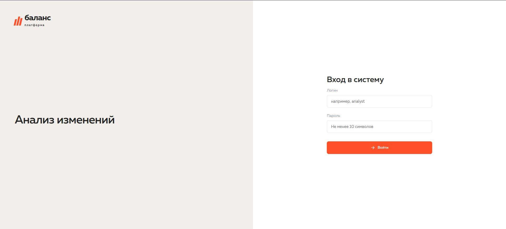
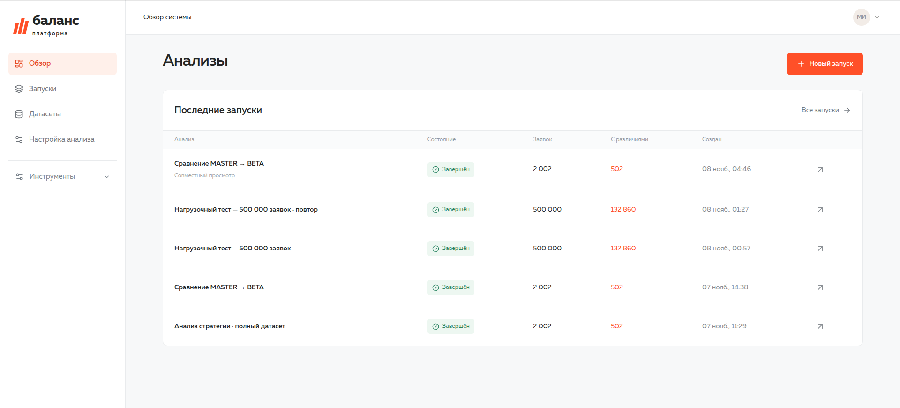
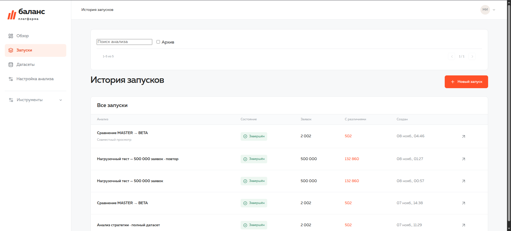
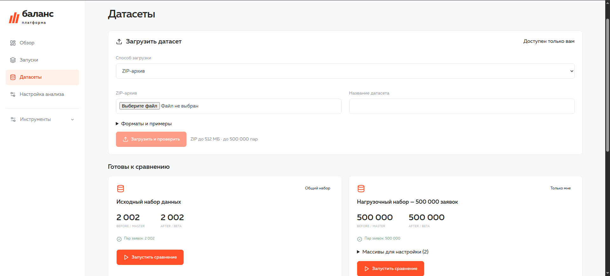
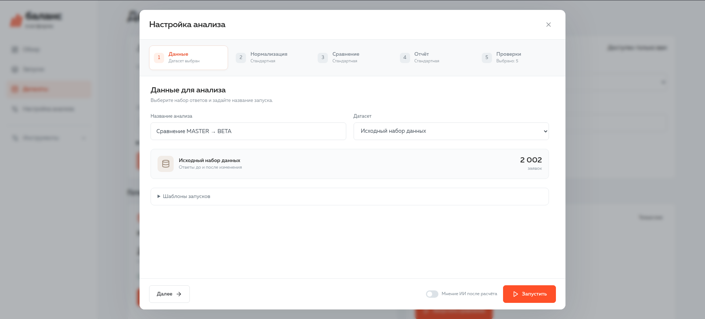
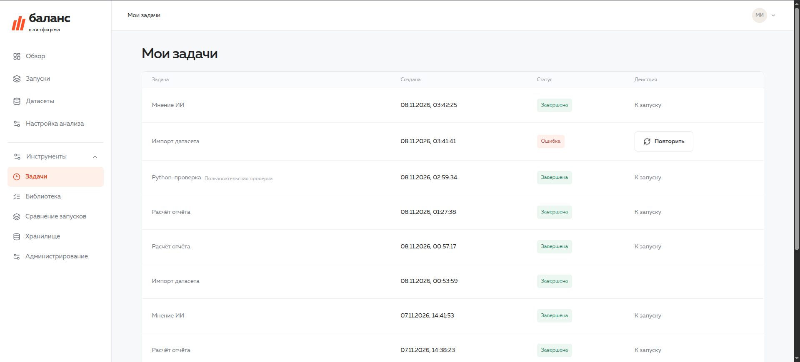
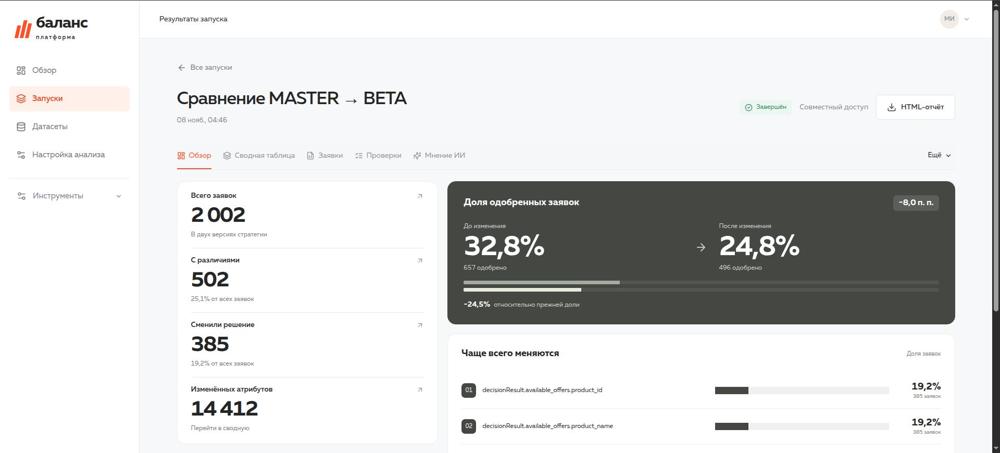
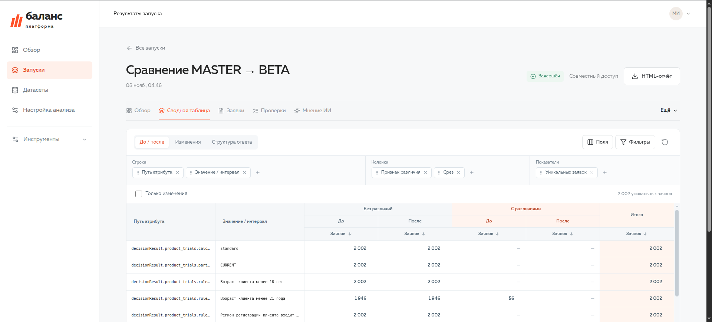
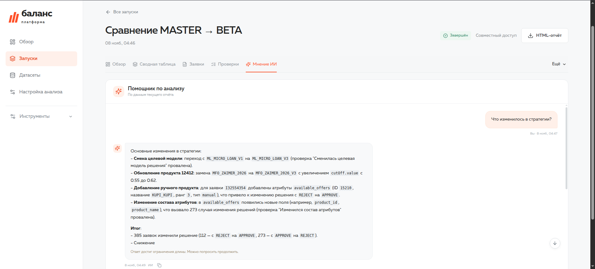

# Баланс · Система анализа изменений

Рабочая основа приложения для сравнения ответов СПР BEFORE / MASTER и AFTER / BETA.
Интерфейс использует локальные шрифты и визуальные мотивы сайта из каталога `дизайн`.

[Скриншоты интерфейса](#скриншоты-интерфейса)

## Быстрый запуск

Требуются Linux, Python 3.12+, Node.js 22+ и npm. Для пользовательского Python необходимы Landlock ABI ≥ 3 и libseccomp2. Выполнять из корня проекта:

```bash
./scripts/setup.sh
./scripts/create-admin.sh  # Только для новой установки без аккаунтов
./scripts/start.sh
```

Приложение: **http://127.0.0.1:8000**. API: **http://127.0.0.1:8000/docs**.

Если архив `ХАКАТОН_СИСТЕМА_АНАЛИЗА_ИЗМЕНЕНИЙ/ПАКЕТ/ЗАДАНИЕ.zip` присутствует рядом с исходниками, его открытый датасет импортируется автоматически. В чистой установке загрузите предоставленный `ЗАДАНИЕ.zip` через «Датасеты» после входа; исходный архив приложения не содержит пользовательских данных и материалов организаторов.
Первого администратора создайте локальной командой `./scripts/create-admin.sh`: она запрашивает логин, имя и пароль без отображения пароля. Команда читает `.env`, использует ту же базу, что и сервер, и работает только пока в базе нет аккаунтов. Существующие отчёты без владельца и конфигурация версии 0.1 закрепляются за первым администратором. Встроенных логинов нет.
Войдите в приложение. Новых сотрудников создаёт администратор через «Администрирование → Новый пользователь»: имя, логин, пароль и роль. Пользователь может изменить свой пароль в настройках профиля. Публичной регистрации и HTTP-маршрута создания первого аккаунта нет. На существующей установке команду создания первого администратора выполнять не нужно.
Готовый отчёт сохраняется; повторный запуск установки не удаляет данные.
Остановка API: Ctrl+C. Redis, Celery и планировщик запускаются отдельно и продолжают работать. Повторный `start.sh` использует уже работающие сервисы. Отменять задания можно в разделе «Задачи».

Дополнительные настройки:

```bash
cp .env.example .env
```

`scripts/start.sh` читает `.env`. По умолчанию сервер слушает только `127.0.0.1`.
Версия **0.11.0** добавляет подключаемые процедуры нормализации, сравнения и агрегации (редактор / `.py`), снимки кода этапов, сводную по вертикальным фактам с точной детализацией, полные списки срабатываний, добавление проверки в готовый отчёт и автоматическое мнение ИИ по настройке. Контракт: [docs/PROCEDURES.md](docs/PROCEDURES.md); сценарий защиты: [docs/DEMO.md](docs/DEMO.md). Старые расчёты сохраняют свои данные и исходные результаты; новые возможности формирования фактов применяются к новым запускам.

Версия 0.10.0 добавляет управление доступом сотрудников, передачу владения, обсуждение и согласование, сравнение запусков, историю ИИ, квоты и проверяемое резервирование (подробнее ниже). Версия 0.9.1 исправляет восемь проблем аудита. Версия 0.9 добавляет роли администратора, пользователя и наблюдателя, совместный просмотр анализов и изменение адреса Ollama через административную страницу. Персональные шаблоны запусков из 0.8 сохранены.

## Что работает

- Создание аккаунтов администратором, вход и выход, сессии на 8 часов с отзывом при выходе.
- Персональные настройки и запуски; проверка владельца на каждом API отчёта, включая JSON, экспорт и ИИ.
- Перенос существующих данных первому аккаунту без изменения файлов отчётов.

- Автоматическое подключение 2002 пар ответов из задания; загрузка своих ZIP и пар CSV/XML через раздел «Датасеты».
- Проверка архива, структуры, JSON и пар; история, прогресс, отмена и повтор; новые наборы доступны только владельцу.
- Визуальная настройка исключений, массивов, числовых интервалов и параметров проверок; переключение в JSON.
- Предпросмотр нормализации на одной паре: диагностика, ключи элементов, типы, исходные значения, интервалы и изменения.
- Личные настройки по умолчанию и отдельная конфигурация запуска с неизменяемым снимком в отчёте.
- Персональные шаблоны запусков с конкретными версиями пользовательских проверок и защитой от конфликтов редактирования.
- Очередь Celery + Redis: два места выполнения, остальные задания ожидают; журнал, прогресс и история в БД.
- Отмена, повтор, лимиты времени/памяти; восстановление после потери исполнителя.
- Вкладка Python: редактор или файл `.py`, параметры, проба либо добавление результата в общий отчёт; сохранённые код, результат и вывод процесса.
- Библиотека процедур: пользовательский Python для нормализации, сравнения и подготовки фактов, выбор процедуры и параметров в запуске и шаблоне. Код этапа доступен из журнала.
- Факты BEFORE/AFTER с сохранёнными связями на заявки; измерения SOURCE, DIFF_FLAG, SUFFIX, значение/бакет, продукт, пороги, офферы и маршрутизация.
- Библиотека проверок: история версий, архив/восстановление, пробный запуск сохранённой версии.
- Выбор штатных проверок и конкретных пользовательских версий при создании расчёта.
- Снимки кода, параметров и версии в каждом новом расчёте; результаты пользовательских проверок в сводке, детализации, HTML и контексте ИИ.
- Нормализация, вертикальная таблица `normalized` с `SOURCE`, сравнение по атрибутам и агрегаты `facts`.
- Четыре типа изменения: `SAME`, `VALUE_CHANGED`, `ATTRIBUTE_NEW`, `ATTRIBUTE_LOST`.
- Поддержка массивов по простому/составному ключу, по индексу и по значению.
- Различение отсутствия поля, `null`, пустой строки и типов скаляров.
- Исключение технических полей и сравнение исходных значений независимо от бакетов.
- Пять штатных Python-проверок на основе материалов задания через `MartAPI`; проверка смены модели восстановлена в исходном виде из архива задания (v1).
- Обзор, конструктор сводной с несколькими осями и показателями, фильтры, отдельная пагинация строк/колонок, карточка заявки и исходные JSON.
- Персональные представления сводной с сохранением, обновлением, удалением и применением к другим своим отчётам.
- Переход из ячейки или итога сводной к точному списку уникальных заявок.
- Переход от количества заявок для пути атрибута к соответствующему списку и конкретному атрибуту.
- Отчёт проверок, мягкая подсветка слабых сигналов, скачивание HTML с обратными ссылками.
- Альтернативное мнение Qwen3 через Ollama: фоновый запрос, сохранение ответа, повтор после ошибки.
- Адаптивное отображение на узком экране.

## Скриншоты интерфейса

### Вход в систему



### Главная страница



### Запуски анализа



### Датасеты



### Настройка анализа



### Задачи и ход выполнения



### Обзор результатов анализа



### Интерактивная сводная таблица



### Чат с ИИ



## Стек этой итерации

Frontend: React, TypeScript, Vite, Lucide, CSS. Backend: FastAPI, SQLAlchemy, DuckDB, HTTPX, Celery и Redis.
Метаданные хранятся в SQLite по умолчанию либо PostgreSQL через `DATABASE_URL`.
У каждого запуска отдельный файл DuckDB; запись заканчивается до публикации результатов.
API открывает опубликованный файл только для чтения.

Celery управляет отдельными ограниченными Python-процессами. Интерфейс опрашивает состояние каждые 2,5–4 секунды; SSE пока не реализован. Redis локально слушает только `127.0.0.1:6380`, данные AOF находятся в `var/redis`.
Если системного Redis нет, `setup.sh` скачивает Ubuntu/Debian-пакеты через apt и распаковывает их в `var/tools` без sudo. Для другой ОС используйте внешний Redis через `REDIS_URL`.
`requirements.lock` и `package-lock.json` фиксируют проверенные версии зависимостей.

## Структура

```text
backend/
  app/
    api.py              HTTP API, проверка прав и раздача frontend
    auth.py             Аккаунты, пароли и сессии
    library.py          Персональная библиотека, версии и снимки проверок
    run_templates.py    Персональные шаблоны запусков, редакции и проверка ссылок
    pivot.py            Матрица сводной, фильтры, итоги, детализация и представления
    normalizer.py       Конфигурируемый разбор и слой разрезов
    normalization_preview.py  Ограниченный предпросмотр пары без записи отчёта
    worker.py           Обработка запуска и построение DuckDB
    queueing.py         Постоянная очередь в БД, доставка Celery, состояния
    dispatcher.py       Доставка ожидающих заданий и восстановление
    tasks.py            Надзор за процессами, отмена, тайм-ауты, публикация
    isolation.py        Landlock и seccomp
    sandbox_entry.py    Загрузка пользовательского кода после установки ограничений
    sandbox.py          Проверка изоляции и валидация результата
    ai.py               Запрос Qwen3
    mart.py             Контракт доступа готовых проверок
    checks/             Пять штатных проверок из задания (исходный код сохранён)
    datasets.py         Подключение входных данных и проверка владельца
    imports.py          Приём ZIP, валидация, атомарная публикация датасетов
    store.py            Метаданные запусков и конфигурация
    settings.py         Пути, подключение БД и Ollama
  tests/                Проверки семантики сравнения
frontend/
  src/                  Интерфейс и стили
  tests/                Сквозной браузерный сценарий
scripts/
  setup.sh              Установка зависимостей и сборка
  start.sh              Запуск приложения
var/                    Локальные данные; не входят в исходный код
  app.sqlite3
  datasets/<dataset>/
  runs/<uuid>/
    result.duckdb
    events.jsonl
  jobs/<uuid>/<attempt>/
    script.py
    params.json
    result.json
    process.log
  worker.log
  dispatcher.log
```

`var` создаётся автоматически. Для другого расположения задайте абсолютный путь `BALANCE_DATA_DIR`.
Не удаляйте исходный датасет после расчёта: карточка заявки читает исходные JSON из него.
Подключённые датасеты следует считать неизменяемыми; изменённый набор размещайте под новым ID.

## Подключение датасета

В разделе **«Датасеты»** выберите способ загрузки: **ZIP-архив**, **Два файла CSV / XML** или **Один общий CSV / XML**. Для пары выберите файлы «До (MASTER)» и «После (BETA)», задайте название и нажмите **«Загрузить и проверить»**. Форматы двух файлов могут различаться. Примеры для скачивания находятся в раскрывающемся блоке «Форматы и примеры». Во время передачи файла оставайтесь на странице; после подтверждения приёма проверка продолжится независимо от браузера. В истории видны статус, прогресс, количество пар и причина ошибки. Ожидающий или выполняющийся импорт можно отменить; неуспешный — повторить без повторной передачи архива.

Структура ZIP:

```text
RESULTS/
  BEFORE_MASTER/A001.json
  AFTER_BETA/A001.json
```

Допускается единая родительская папка (в том числе вложенная) и необязательный `manifest.json` рядом с `RESULTS`. Сопутствующие файлы вне `RESULTS` не извлекаются и не исполняются. Можно загрузить исходный `ЗАДАНИЕ.zip` целиком. Служебные файлы macOS игнорируются. Внутри `RESULTS` допускаются JSON, CSV и XML в двух указанных каталогах. CSV может содержать несколько заявок; XML — одну заявку или список. Также поддерживается ZIP с файлами `BEFORE.csv` / `AFTER.csv` (либо `.xml`) на одном уровне, в том числе в общей родительской папке.

Проверяется следующее:

- Непустой одинаковый набор ID до/после; повтор ID в одной версии отклоняется, включая повторы между файлами разных форматов. Для JSON ID берётся из имени файла: до 100 латинских букв, цифр, точек, дефисов и подчёркиваний; первый символ — буква или цифра.
- UTF-8 (допускается BOM), объект в корне JSON, отсутствие повторных ключей и неконечных чисел; до 64 уровней и 200 000 узлов на файл. `appData` и `decisionResult`, если присутствуют, должны быть объектами.
- Для JSON `appData.application_id`, если указан, совпадает с именем файла. Отсутствие ID в одиночном JSON/XML внутри ZIP допустимо: используется имя файла. Для CSV, списков XML и загрузки пары файлов ID обязателен.
- Безопасные пути, отсутствие ссылок, специальных файлов, повторов путей без учёта регистра, шифрования и чрезмерного сжатия. Поддерживаются ZIP Store/Deflate.

Лимиты: ZIP **512 МиБ**, суммарно **1 ГиБ** распакованных файлов, **16 МиБ** на JSON-документ и **512 МиБ** на потоковый CSV/XML, до **1 000 000 исходных файлов**, не более **500 000 пар заявок**, до 100 дополнительных ZIP-записей; степень сжатия не выше 500. Эти ограничения проверяются и для сопутствующих файлов. Приём ограничен двумя одновременными передачами на процесс API и 180 секундами; у аккаунта одновременно до трёх активных импортов. Проверка занимает одно из двух общих мест очереди, лимиты импорта — 1800 секунд и 2048 МиБ. CSV и XML читаются порциями без загрузки всего файла в память.

**CSV:** UTF-8 с необязательным BOM; разделитель — запятая, точка с запятой или табуляция. Одна строка — одна заявка. Требуется ровно одна колонка `application_id`, `APP_ID` или `appData.application_id`. Заголовки с точками задают вложенные поля (`decisionResult.decision`); конфликты вроде `a` и `a.b`, повторные колонки, лишние и недостающие значения отклоняются. Числа, `true`, `false`, `null`, JSON-объекты и массивы распознаются в ячейках. Чтобы сохранить числовое значение как строку, поместите в ячейку JSON-строку с кавычками. Пустая ячейка — пустая строка. ID сохраняется как текст, включая ведущие нули. Предел — 1000 колонок.

**XML:** одиночный объект или корень `applications` / `records` / `rows` со списком `application` / `record` / `row`. ID читается из `appData.application_id`, прямого поля `application_id`, атрибута заявки `application_id` / `id` или атрибута `appData.application_id`. Корневой контейнер и пространства имён снимаются; столкновения локальных имён разных пространств внутри объекта отклоняются. Обычные атрибуты сохраняются с префиксом `@`. Повторные одноимённые элементы становятся массивом; для стабильного массива из нуля/одного/нескольких элементов используйте `<field type="array"><item>…</item></field>`. Поддерживаются явные типы `string`, `number`, `boolean`, `null`, `object`, `array` и `xsi:nil`. Смешанный текст с дочерними элементами, DTD и объявления сущностей отклоняются. Числа и логические значения определяются по тем же правилам, что в CSV. Парсер ограничивает глубину и число узлов до построения JSON.

Оба формата преобразуются в тот же набор JSON-документов, с которым работают расчёт, сводная, штатные и пользовательские проверки, ИИ и просмотр исходных данных. Преобразованные документы дополнительно проходят общую проверку сложности и размера: до 16 МиБ на заявку и 1 ГиБ на набор. При загрузке пары или общего файла браузер читает файлы потоком и упаковывает их без сжатия в ZIP; оригинальные имена сохраняются в манифесте, содержимое не меняется. Общий HTTP-импорт, повтор, отмена, квоты, приватность и резервное копирование используют существующий путь ZIP.

**Один общий файл:** CSV содержит колонку `SOURCE` (или `SIDE`) со значениями `BEFORE` / `AFTER`; на каждый ID должно быть по одной строке каждой версии. XML имеет корень `<dataset>` с разделами `<BEFORE>` и `<AFTER>`, внутри — элементы `<application>`. В ZIP общий файл называется `dataset.csv` / `dataset.xml` (также распознаются `data` и `comparison`). Пара отдельных файлов и ZIP с большим количеством маленьких файлов остаются доступны; все варианты используют одинаковый расчёт.

**Хранение:** небольшие наборы сохраняются в прежних каталогах JSON. После 2000 документов импорт переключается на `documents.sqlite3` с индексом `(side, app_id)`, сохраняя данные и типы без изменения. Так большой набор не создаёт миллион файлов. API исходных ответов, предпросмотр, сравнение и проверка резервных копий поддерживают обе формы хранения.

Готовый набор появляется только после проверки всех файлов. Он доступен только загрузившему его аккаунту, включая создание расчёта и чтение исходного JSON через отчёт. Кнопка **«Запустить сравнение»** заранее выбирает этот набор. Каждая загрузка или повтор получает новый ID `upload-<UUID>`; совпадение названий не приводит к перезаписи. Папки с префиксом `upload-` зарезервированы для реестра импортов и никогда не считаются общими по наличию на диске.

**Проверка импорта не заменяет настройку нормализации.** Карточка показывает найденные пути массивов (до 200); задайте для них правила в настройках или расширенной конфигурации запуска. Например, неверный ключ сопоставления или точка в имени поля могут привести к диагностической ошибке уже при расчёте.

Оригинальные ZIP сохраняются в `var/uploads`, реестр и история — в БД, готовые наборы — в `var/datasets`. Архивы неуспешных импортов остаются для повтора; автоматического удаления принятых архивов и датасетов пока нет. Незарегистрированные незавершённые загрузки старше суток очищаются при запуске API. Повреждённый ZIP следует исправить и загрузить заново: повтор проверяет тот же исходный файл. Временные распакованные файлы удаляются при штатном окончании попытки; после аварии — перед следующей попыткой этого задания.

Для ручного подключения **общего для всех аккаунтов** набора администратором локальной установки разместите данные следующим образом и обновите страницу:

```text
var/datasets/MY-RUN/
  manifest.json
  RESULTS/
    BEFORE_MASTER/<APP_ID>.json
    AFTER_BETA/<APP_ID>.json
```

Минимальный `manifest.json`: `{"run_id":"MY-RUN"}`.
В текущей версии имена каталогов срезов фиксированы, а структура самих ответов настраивается.
Идентификаторы двух наборов должны совпадать; непарный или пустой набор завершает запуск диагностической ошибкой.
Новые пути массивов необходимо описать в конфигурации, иначе запуск сообщит, для какого массива не задан режим.

Пример части конфигурации:

```json
{
  "exclude_paths": ["appData.request_id", "appData.createDateTime"],
  "arrays": {
    "decisionResult.available_offers": {"mode":"key", "keys":["product_id", "type"]},
    "decisionResult.scoring.value": {"mode":"index"}
  },
  "buckets": {
    "decisionResult.product_trials.scoring.pd.value": [0.3, 0.6, 1]
  },
  "check_params": {"max_drop_rel":0.1, "low_confidence_cnt":5, "app_ids_limit":100}
}
```

Это фрагмент для объяснения: полный набор массивов выданного датасета уже есть в настройках по умолчанию.

## Визуальная настройка нормализации

В **«Настройке анализа»**, в параметрах соответствующих этапов, доступны:

- Исключения по полному пути: исключаются поле и все его дочерние поля.
- Массивы: сопоставление **по ключам**, **по позиции** или **по значению**. Для составного ключа укажите каждый путь внутри элемента с новой строки (например `product_id` и `type`). Режим по значению подходит для скаляров; повторные значения объединяются. Если массив исключён, редактор поясняет, что правило не применяется.
- Числовые интервалы: путь атрибута и возрастающие границы через запятую, например `0.3, 0.6, 1`. Десятичный разделитель — точка, верхняя граница включена. Интервалы группируют значения, но не скрывают изменение исходного числа. Пустой список отключает группировку.
- Параметры штатных проверок: порог падения одобрений, минимальное число наблюдений и лимит примеров.

Нажмите **«Сохранить»**, чтобы использовать настройки в новых запусках. В форме создания расчёта раскройте **«Параметры этого запуска»** — там тот же редактор, но изменения относятся только к данному расчёту. Переключатель **JSON** сохраняет возможность ручного редактирования. При неверном JSON переход к визуальной форме блокируется, пока ошибка не исправлена. Незавершённые строки визуального редактора не сохраняются; их нужно заполнить или удалить. Уход со страницы без сохранения сбрасывает черновик.

**«Проверить правила»** запускает пробу на выбранном датасете. Можно указать ID заявки; если поле пустое, выбирается первая пара по ID. Сначала исправьте ошибки режима/ключей массива, затем проверьте соответствие BEFORE/AFTER: видны путь, ключ элемента, тип значения, интервал и вид изменения. Отсутствующее поле, JSON `null` и пустая строка различаются. При изменении настроек, датасета или ID старый результат сбрасывается; запоздавший ответ не заменяет результат новой пробы.

Предпросмотр использует основной нормализатор и не создаёт задачу, отчёт или сохранённую конфигурацию. Он проверяет **одну пару**, а не весь набор и не штатные проверки отчёта. Лимиты: 1 МиБ и 20 000 узлов JSON на срез, 4 МиБ символов в нормализованных путях/ключах/значениях на срез. В таблице выводятся первые 100 атрибутов (сначала изменения); значения длиннее 240 символов сокращены. Полный расчёт остаётся необходимым для проверки всего датасета. API: `POST /api/datasets/{dataset_id}/normalization-preview` с телом `{"config": {...}, "app_id": "A001"}`; `app_id` необязателен, доступ к набору проверяется по текущему аккаунту.

Ограничения конфигурации одинаковы для сохранения, предпросмотра и создания расчёта: до 100 исключений, 200 правил массивов, 100 правил интервалов и 100 границ на правило; до восьми частей составного ключа. Пути должны состоять из непустых частей через точку, без пробелов по краям и управляющих символов. Повторные исключения и части ключа отклоняются.

## Шаблоны запусков

В форме **«Новый запуск»** раскройте **«Шаблоны запусков»**. Настройте название расчёта, датасет, проверки и параметры нормализации; введите название шаблона и нажмите **«Сохранить как новый шаблон»**. Это сохраняет настройки без постановки расчёта в очередь и не меняет личную конфигурацию по умолчанию.

Чтобы повторить сценарий, выберите запись в **«Мои шаблоны»** и нажмите **«Применить шаблон»**. Название запуска, датасет, конфигурация и выбор проверок в форме заменятся сохранёнными. Их можно скорректировать перед нажатием **«Запустить»**, в том числе выбрать другой датасет. В разделе «Состав сохранённого шаблона» показаны сохранённый набор и версии; несохранённые изменения формы там не отображаются.

**«Обновить шаблон»** сохраняет текущую форму и название шаблона в новую редакцию. Кнопка доступна после применения или создания записи. Если другая вкладка уже обновила шаблон, сервер возвращает 409 и сохраняет ваш черновик в форме. Примените актуальный вариант (это заменит черновик) либо сохраните свои изменения как отдельный шаблон. Обновление списка само по себе не меняет настройки формы и не снимает защиту от конфликтов обновления.

**«Удалить шаблон»** требует подтверждения в форме и проверки редакции. Удаляются только настройки шаблона: датасет, личная конфигурация, уже созданные задания и отчёты сохраняются. У шаблонов нет истории старых редакций: номер редакции защищает от перезаписи изменений, а не служит архивом версий. Названия могут повторяться; записи независимы.

Пользовательские проверки сохраняются по точным ID неизменяемых версий, вместе с объединёнными параметрами версии и переопределениями. Появление v2 в библиотеке не заменяет v1 в шаблоне. Штатные проверки сохраняются явным списком ID; их код берётся из текущей поставки приложения при создании расчёта. Каждый расчёт, как и раньше, получает собственный снимок конфигурации, кода и параметров проверок.

Если выбранный датасет недоступен или проверка архивирована, шаблон остаётся доступен для чтения и исправления. При применении показывается причина; недоступную проверку можно убрать в форме, а набор — заменить. Создание расчёта повторно проверяет все ссылки. Шаблоны видны только владельцу; чтение, обновление и удаление чужого ID возвращают 404. Они хранятся в новой таблице `run_templates`; существующие таблицы и отчёты не преобразуются.

API: `GET/POST /api/run-templates`, `GET/PUT/DELETE /api/run-templates/{id}`. Создание принимает `{"name":"Название шаблона","spec":{...тело POST /api/runs...}}`; обновление дополнительно требует `revision`, удаление — параметр `?revision=N`. Список содержит метаданные, полная конфигурация и диагностика ссылок возвращаются при чтении отдельной записи.

## Модель сравнения и принятые решения

1. Уникальность атрибута: `APP_ID + PATH + ARRAY_KEY`. Контекст всех массивов сохраняется.
2. Тип значения хранится отдельно. JSON `false` отличается от строки `"false"`, JSON `null` — от строки `"NULL"`.
3. Числа `1` и `1.0` считаются одинаковыми. `null → false` считается изменением.
4. Режим `value` использует семантику множества: порядок и повторения одинакового скаляра не учитываются.
5. Пустые массивы и объекты не создают листовых атрибутов; они доступны в исходном JSON.
6. По умолчанию справочники включены в сравнение. Их можно исключить через `exclude_paths`.
7. Технический слой — вертикальный `normalized`; совместимое горизонтальное представление `comparison` предоставляется проверкам через `MartAPI`.
8. `facts` содержит `CNT` по измерениям. В начальной сводной уникальные заявки пересчитываются из `comparison`, чтобы исключить двойной счёт при объединении групп. Конструктор сводной также пересчитывает уникальные заявки по исходным строкам, присоединяя слой applications один к одному.
9. Для одиночных полей модели/порога в слое разрезов выбирается продукт с лексикографически минимальным `product_id` отдельно в каждом срезе. Эти одиночные поля сохранены для совместимости. `mart.product_segments()` возвращает отдельный контекст каждого продукта и сохранён для совместимости с существующими снимками проверок. Исходная штатная проверка смены модели (v1) использует одиночные поля из `mart.segments()`: смена основного продукта тоже может дать результат о смене модели. В новых расчётах используется исходная проверка из архива задания; код и результаты существующих расчётов сохраняются.
10. Выданная проверка Approval Rate использует итоговое решение заявки в группе продуктов. Это не отдельная метрика решения по каждому продукту.
11. Ссылки из проверок показывают доступные `APP_IDS`; список может быть короче `CNT`. В интерфейсе ограничение отмечено.
12. Основной отчёт публикуется только после завершения обработки и проверок. ИИ запускается пользователем отдельно и не блокирует отчёт.

## Ollama

По умолчанию:

```env
OLLAMA_BASE_URL=http://192.168.1.76:11434
OLLAMA_MODEL=qwen3-server:latest
OLLAMA_TIMEOUT_SECONDS=300
OLLAMA_MAX_TOKENS=512
```

Администратор может изменить адрес и модель в разделе «Администрирование → Подключение к ИИ». Сохранённые в БД значения имеют приоритет над `OLLAMA_BASE_URL` и `OLLAMA_MODEL`; переменные окружения задают начальные значения. Допускаются базовый адрес и полный URL `/api/chat`. «Проверить соединение» запрашивает `/api/tags`, проверяет наличие указанной модели и заполняет подсказки поля «Модель» установленными моделями. Результат или ошибка показываются рядом с кнопкой; проверка не сохраняет настройки и не запускает генерацию. «Сохранить настройки» меняет сервер и модель для новых запросов чата и автоматического мнения. Настройки уже созданных задач остаются зафиксированными; изменения записываются в журнал действий.

Приложение использует `POST /api/chat`, `stream=false`, `think=false`. В чате ожидается текстовый ответ; автоматическое мнение дополнительно требует поддержку JSON Schema выбранной моделью. Наличие модели в `/api/tags` само по себе не подтверждает успешную генерацию.
Для совместимости с шаблоном `qwen3-server` в запрос добавляется `/no_think` — [переключатель Qwen3](https://github.com/QwenLM/Qwen3/blob/main/README.md).
Ответ проверяется как объект с полями `summary`, `signals`, `next_steps`; некорректный JSON не публикуется как готовый отчёт.
В контекст входят основные агрегаты и сводка пяти проверок с максимум двумя примерами на проверку, без исходных документов и идентификаторов заявок. Это ограничивает задержку на CPU; модель видит явно обозначенную выборку сигналов.
Ответ отображается как текст, а не как исполняемый HTML. При недоступности модели сохраняется ошибка с возможностью повторить запрос.
Подключение к указанной локальной модели и получение структурированного ответа проверены.
На момент проверки Ollama сообщала `size_vram=0`, поэтому первоначальный запрос с большим контекстом превысил 180 секунд.
В рабочей конфигурации контекст сокращён, ответ ограничен 512 токенами, тайм-аут увеличен до 300 секунд.

## Проверки

На выданном датасете с конфигурацией по умолчанию получено:

| Показатель | Результат |
| --- | ---: |
| Заявки | 2002 |
| Заявки с различиями | 502 |
| Заявки со сменой решения | 385 |
| Различия при прежнем решении | 117 |
| Сопоставленные атрибуты | 289 533 |
| Изменённые атрибуты | 14 412 |
| Строки отчёта пяти проверок | 32 |

Два полных запуска заняли 48,61 и 43,53 секунды в текущем окружении. Выборки сводной и заявок
при локальных HTTP-замерах заняли 144–154 мс. Это измерения конкретной машины, не гарантия для другого сервера.
Переходы решений дополнительно сверены напрямую с исходными JSON. Закрытый эталон организаторов не использовался.
На этапе 0.5 пройдены 59 backend-тестов: 10 по сравнению, 7 по аккаунтам, 20 по очереди/изоляции Python, 11 по библиотеке/интеграции проверок и 11 по сводной/представлениям. Они проверяют конкурирующие захваты задания, восстановление, отмену, лимиты и реальные попытки доступа к файлам, сети, процессам и управляющим системным вызовам. Браузерные сценарии работают на отдельной базе и создают настоящие отчёты. Рабочие аккаунты и данные при проверках не используются. На этапе 0.4 пройдены пять браузерных сценариев: два прежних сценария аккаунтов, полный рабочий сценарий отчёта, библиотека с включением v1 в расчёт и пробой v2, восстановление старой версии как новой. Сценарий отчёта включает редактор Python, сохранение в библиотеку, результат 502 / 2002, тайм-аут, отмену и повтор.

На этапе 0.5 прошли два браузерных сценария: обновлённый полный рабочий сценарий и конструктор сводной. Проверены две оси по два поля, три показателя, фильтр по решению (385 заявок), точная детализация, применение представления к другому своему отчёту, обновление/удаление, запрет доступа другого аккаунта, пагинация колонок и мобильная ширина. Unit-тесты отдельно проверяют непересчитываемость итога суммой ячеек, NULL/пустую строку, пустые оси/выборки, безопасность SQL и конфликт редакций. Результат обновления рабочей базы и готовности сервера — `artifacts/pivot-validation.json`.

На этапе 0.8 пройдены **117 backend-тестов**, включая 10 новых сценариев шаблонов: CRUD, владение, конкретные версии и параметры проверок, сохранность созданных расчётов, архивные ссылки, замена недоступного набора, конкурентное обновление и повторная инициализация БД. Браузерные сценарии проверяют шаблон от сохранения до расчёта и удаления, конфликт редакций, v1 после публикации v2, приватность и мобильный экран; дополнительно проверены два сценария библиотеки и визуальный редактор нормализации. Артефакты: `artifacts/templates-backend-tests.xml`, `artifacts/templates-validation.json`, `artifacts/templates-desktop.png`, `artifacts/templates-mobile.png`.

На этапе 0.7 пройдены **107 backend-тестов**, включая 17 новых сценариев валидации конфигурации и предпросмотра. Проверены перестановки по ключам, режимы index/value, отсутствующие и типизированные значения, интервалы без потери исходного различия, приватность, ограничение входа/выхода и сохранность настроек после ошибки. В браузере проверены визуальный редактор, JSON-переход, личные настройки, отдельные правила запуска и неизменяемый снимок в отчёте; также пройдены сценарии двух аккаунтов, переключения аккаунта между вкладками и полного рабочего отчёта. Результаты: `artifacts/normalization-backend-tests.xml`, `artifacts/normalization-validation.json`; скриншоты: `artifacts/normalization-desktop.png` и `artifacts/normalization-mobile.png`.

На этапе 0.6 добавлен 31 тест импорта: проверка JSON и ZIP, ограничения, обрыв передачи и очистка, атомарное ограничение очереди, отмена перед публикацией, восстановление после переименования, приватность и реальное исполнение в дочернем процессе. Браузерный сценарий проверяет загрузку, выбор набора в расчёте, исходный JSON, запрет доступа другого пользователя, ошибку непарных данных, повтор и мобильный экран; прежний полный рабочий сценарий отчёта также пройден. Исходный `ЗАДАНИЕ.zip` загружен целиком: 4004 JSON / 2002 пары, результат расчёта — 502 изменившиеся заявки и 385 смен решений. Подробности — `artifacts/import-full-dataset-validation.json`, отчёты backend-тестов — `artifacts/import-backend-tests.xml` и `artifacts/import-array-inventory-test.xml`, результат обновления рабочей установки — `artifacts/import-validation.json`.

Полный расчёт с пятью штатными и одной пользовательской проверкой дал 33 строки. Архивирование после постановки в очередь сохранило v1 в расчёте; пробный запуск v2 с другим порогом дал PASS, не изменив FAIL в исходном отчёте. Проверены снимки кода/параметров, переход к заявкам, HTML-экспорт, мобильный экран и отсутствие доступа другого аккаунта. Контекст ИИ проверен тестовым HTTP-транспортом: он включает имя, версию и результаты пользовательской проверки без её кода. Проверка обновления рабочей базы и готовности сервисов — `artifacts/library-validation.json`.

На отдельной установке проверены три задания при двух местах исполнения, отмена ожидающего и выполняющегося задания, принудительное завершение Celery-процесса с автоматическим повтором, отсутствие повторного исполнения готовой задачи и перезапуск API с сохранением сессии и работы. На этапе 0.3 Qwen3 через очередь вернул готовый ответ за 70,4 сек. Результаты проверки сервисов сохранены в `artifacts/queue-validation.json`.

Семантические тесты:

```bash
cd backend
BALANCE_DATA_DIR=/tmp/balance-unit-tests ../.venv/bin/python -m pytest -q
```

Браузерные тесты создают аккаунты и настоящие запуски. Запускайте их на отдельной базе, с отдельным администратором; тесты получают его учётные данные через переменные окружения:

```bash
# Терминал 1, из корня проекта
BALANCE_DATA_DIR=/tmp/balance-browser-tests ./scripts/create-admin.sh
BALANCE_DATA_DIR=/tmp/balance-browser-tests REDIS_URL=redis://127.0.0.1:6380/1 \
BALANCE_QUEUE=balance-tests PORT=8001 ./scripts/start.sh
```

Во втором терминале:

```bash
cd frontend
npx playwright install chromium
export BASE_URL=http://127.0.0.1:8001
export BALANCE_TEST_ADMIN_USERNAME=your_test_admin
read -rsp 'Пароль тестового администратора: ' BALANCE_TEST_ADMIN_PASSWORD
export BALANCE_TEST_ADMIN_PASSWORD
npx playwright test
```

Сценарии проверяют создание аккаунтов администратором, вход/выход, два одновременных запуска от разных пользователей, персональные конфигурации, запрет прямых ссылок на чужие данные, сохранение состояния после перезагрузки, сводную, детализацию заявки, исходный JSON, проверки, HTML-экспорт и узкий экран. Скриншоты сохраняются в `artifacts/`.

Сборка frontend:

```bash
npm --prefix frontend run build
```

Для разработки с автообновлением интерфейса:

```bash
# Терминал 1 — backend
./scripts/start.sh

# Терминал 2 — frontend, из корня репозитория
npm --prefix frontend run dev
```

Vite использует `/api` proxy к FastAPI. После первой сборки или изменения набора статических файлов перезапустите backend.

## Docker Compose

Для новой машины подготовлены образ приложения, Redis, обработчик задач и планировщик. Python и Node.js устанавливать на хост не нужно.

```bash
# Ubuntu / Debian, если Docker ещё не установлен:
sudo ./scripts/install-docker.sh
cp .env.docker.example .env.docker
sudo ./scripts/docker.sh up
sudo ./scripts/docker.sh admin
```

Сайт: **http://127.0.0.1:8080**. `admin` создаёт первого администратора; остальные аккаунты создаются через интерфейс. Данные сохраняются в постоянных томах. Если Docker доступен вашему пользователю, `sudo` не нужен.

Подробности, требования к ядру, доступ из сети, Ollama, обновление и проверка сохранности данных: [docs/DOCKER.md](docs/DOCKER.md). Для автоматической проверки на отдельном временном окружении: `./scripts/docker-smoke.sh`. Docker Engine в текущей среде отсутствует; контейнерная сборка здесь не подтверждена.

## Очередь и управление задачами

Раздел **«Задачи»** показывает только задания текущего аккаунта. Расчёт, запрос ИИ и пробная проверка проходят через одну очередь. Два задания исполняются одновременно; новые задачи сохраняются без отказа из-за занятых мест.

Состояния: `queued → running → completed / failed / timed_out`. Отмена ожидающего задания сразу даёт `cancelled`; выполняющегося — `cancelling → cancelled` после остановки дочернего процесса. Повтор создаёт новое задание; повтор расчёта создаёт отдельный отчёт с копией исходной конфигурации.

Сначала задание фиксируется в БД, затем независимый планировщик доставляет его в Redis. При недоступности брокера задания остаются в БД. Повторная доставка не запускает одновременно одну задачу: используются блокировка, атомарный захват и идентификатор попытки. Результат устаревшей попытки не публикуется.

Исполнитель обновляет heartbeat каждые 3 секунды. Если его нет 45 секунд, планировщик повторяет оборванную задачу с начала один раз; после второй потерянной попытки фиксирует ошибку. Отменённые задачи автоматически не повторяются. Отмена ИИ закрывает локальный HTTP-запрос; прекращение самой генерации зависит от Ollama.

Лимиты по умолчанию: расчёт 600 сек. / 4096 МБ, ИИ 330 сек. / 1024 МБ. Для Python в форме выбираются 1–60 сек. и 512–2048 МБ. Время ограничивается по реальным часам и CPU, память — через жёсткий `RLIMIT_AS` (адресное пространство, не RSS).

Файлы PID и логи: `var/{worker,dispatcher,redis}.pid` и `.log`. Для диагностики доступны `/api/runtime`, `/api/jobs`, `/api/jobs/{id}`, отмена `/cancel` и повтор `/retry`. Все требуют входа; задания проверяют владельца.

## Пользовательский Python

Откройте готовый отчёт → **Python**. Пример в редакторе вычисляет долю изменившихся заявок. Параметры передаются JSON-объектом. Код экспортирует `CHECK = {"entrypoint": run}`, где `run(mart, params)` возвращает список строк с полями `LABEL`, `SOURCE`, `ARGUMENT`, `CNT`, `TOTAL`, `METRIC`, `RESULT`, `CONFIDENCE`, `APP_IDS`.

`mart.rows`, `mart.count` и `mart.app_ids` принимают фильтры `path`, `path_prefix`, `key`, `array_key`, `diff_flag`, `change_type`, `value_before`, `value_after`, `app_ids`. Дополнительно доступны `mart.segments()` и `mart.total_apps()`.

Перед загрузкой пользовательского кода отдельный процесс устанавливает [Landlock](https://docs.kernel.org/userspace-api/landlock.html), seccomp и жёсткие лимиты ресурсов. Landlock устанавливается до импорта DuckDB, чтобы библиотечные потоки унаследовали ограничения. Разрешены чтение выбранного отчёта, библиотек Python/системы и необходимых системных сведений о CPU/памяти. Закрыты файлы приложения, чужие отчёты и произвольная запись. Seccomp запрещает сеть, создание процессов, управляющие и опасные системные вызовы. Окружение очищается, посторонние дескрипторы не наследуются.

Это ограниченный процесс Linux, а не отдельная виртуальная машина. Защита зависит от ядра и libseccomp. API предварительно проверяет настоящий дочерний запуск и отказывает при недоступности защиты; каждая задача повторно устанавливает ограничения. После изменения политики ОС перезапустите API для повторной проверки доступности.

Код — до 50 000 символов, параметры — до 16 КБ. Результат и файл вывода процесса ограничены 1 МБ каждый; API возвращает последние 16 КБ вывода. Проверяются типы и значения результата (до 1000 строк), конечность метрик и принадлежность `APP_IDS` отчёту. Эти проверки подтверждают формат, но не математическую корректность пользовательской логики. Пробный результат хранится отдельно и не меняет основной HTML-отчёт. Для включения результата в отчёт сохраните проверку в библиотеку и выберите её при создании нового расчёта.

## Конструктор сводной

В готовом отчёте откройте **«Сводная таблица»**. Основной экран — интерактивная таблица с закреплёнными заголовками и итогами. Раскладки «До / после», «Изменения» и «Структура ответа» переключают группировку одним нажатием. Последняя повторяет поля предоставленного прототипа WebDataRocks; расчёт выполняется сервером, чтобы корректно учитывать уникальные заявки на больших данных.

Перетаскивайте плашки между строками и колонками или меняйте их порядок. Кнопка **«Поля»** открывает выбор до шести полей строк, трёх полей колонок и трёх показателей. Поля не повторяются между осями; пустая ось означает одну общую группу. Настройки окна вступают в силу после «Применить», изменения непосредственно на панели пересчитывают таблицу автоматически. Нажатие заголовка поля сортирует по значениям, заголовка количества заявок или атрибутов — по убыванию итога. Во время пересчёта переход из прежних ячеек недоступен.

Доступны путь, блок, класс и имя атрибута, ключ массива, тип изменения, значения/типы/бакеты BEFORE и AFTER, решения и модели обоих срезов, набор продуктов и набор типов партнёра. Последние два — целые наборы из слоя разрезов, а не развернутые отдельные продукты. Политика выбора основной модели остаётся прежней.

Можно выбрать до трёх показателей: уникальные заявки, атрибуты, заявки с различиями, изменённые атрибуты, заявки со сменой решения. Все показатели относятся к отфильтрованным строкам сравнения. Например, при фильтре пути количество заявок со сменой решения учитывает только заявки, имеющие подходящую строку этого пути.

Кнопка **«Фильтры»** открывает условия отбора. До двенадцати фильтров объединяются условием **И**. Условия: равно, одно из значений (по одному в строке), содержит, начинается с, NULL и не NULL. Поиск подстроки/префикса не зависит от регистра; равенство — точное. Переключатель «Только изменения» ограничивает выборку `DIFF_FLAG=1`. Отсутствующее значение SQL NULL, пустая строка и текст `NULL` — разные группы; для различения исходных JSON-типов используйте поля «Тип значения».

Матрица показывает 25 групп строк и 8 групп колонок на страницу. Каждая ось имеет независимую пагинацию: стрелки переключают соседние страницы, поле между ними позволяет ввести номер и перейти по Enter или при выходе из поля. Номер ограничивается диапазоном от 1 до последней страницы; некорректный ввод возвращает текущий номер. API допускает максимум 50 × 12. Итог строки относится ко **всем** колонкам, итог колонки — ко **всем** строкам, общий итог — ко всей отфильтрованной выборке. Они не ограничиваются видимой страницей. `COUNT(DISTINCT APP_ID)` пересчитывается для каждого уровня: одна заявка может присутствовать в нескольких ячейках, поэтому складывать их количества для получения итога нельзя.

Нажмите ненулевое число в ячейке или итоге, чтобы увидеть уникальные заявки с теми же фильтрами и координатами. Для показателей изменений и смены решения дополнительно применяется соответствующее условие метрики. При переходе от количества атрибутов список всё равно содержит уникальные заявки; это явно обозначено. Карточка заявки сначала показывает атрибуты выбранной ячейки; «Показать всю заявку» снимает это ограничение; кнопка «К списку заявок» возвращает к выбранной ячейке, а «К сводной» — к той же странице матрицы.

Кнопка **«Виды»** открывает сохранённые представления. Они сохраняют поля, показатели, фильтры и сортировку, без данных и привязки к одному отчёту. Они доступны только текущему аккаунту и применяются к любому его готовому отчёту. «Сохранить как новое» создаёт запись; «Обновить представление» проверяет номер редакции и возвращает 409 при конфликте другой вкладки. Обновите список и выберите представление, чтобы получить актуальные настройки. Удаление представления не меняет отчёт или текущую матрицу. Несохранённые настройки при перезагрузке страницы сбрасываются.

API: `GET /api/pivot-schema`, `POST /api/runs/{id}/pivot/query`, `POST /api/runs/{id}/pivot/applications`, `GET/POST /api/pivot-views`, `PUT/DELETE /api/pivot-views/{id}`. Запрос матрицы содержит `spec`, `row_page`, `column_page`, `row_limit`, `column_limit`; детализация — `spec`, ключи `row`/`column`, `metric` и страницу. Для общего итога ключ оси передаётся как null. Обновление/удаление представления требуют `expected_revision`. Старый GET `/pivot` оставлен для совместимости.

Расчёт выполняется по `comparison JOIN applications USING(APP_ID)`, без суммирования агрегатов `facts.CNT`; SQL-поля и показатели выбираются из разрешённого списка, значения передаются параметрами. Матрица вычисляет только видимые сочетания координат, а итоги и число групп — по полной выборке. При обновлении добавляется таблица `pivot_views`; файлы DuckDB и прежние отчёты не меняются.

## Библиотека и версии проверок

1. В **«Настройке анализа → Автоматические проверки»** выберите **«Свой Python»**, введите код или загрузите `.py`, затем **«Сохранить и применить»**. Для управления сохранёнными версиями доступна **«Библиотека → Проверки»**. Код также можно перенести из вкладки Python кнопкой «Сохранить в библиотеку».
2. Любое изменение сохраняется новой версией. История позволяет открыть старую версию и сохранить её как следующую. Синтаксис проверяется без исполнения кода. Сохранение из устаревшей вкладки получает 409; «Обновить историю» сохраняет текст редактора и обновляет номер ожидаемой версии.
3. Для пробного запуска выберите готовый собственный отчёт и нажмите **«Проверить vN»**. В задаче остаются код, параметры, имя и версия; последующее редактирование библиотеки их не меняет.
4. В **«Новом запуске»** отметьте нужные штатные проверки и выберите версии пользовательских. По умолчанию включены пять штатных проверок; пользовательские добавляются явно. Можно отключить все проверки и получить только сравнение.
5. В отчёте → **«Проверки»** видны состав расчёта, версия, состояние, число строк и точный снимок кода/параметров. Результаты пользовательских проверок поддерживают переход по APP_IDS, HTML-экспорт и мнение ИИ. FAIL — строка результата проверки, а не ошибка исполнения.

Библиотека доступна только владельцу. Удаление заменено архивированием: архивная проверка скрыта в обычном списке и недоступна для выбора в новых расчётах, но её версии, пробы и старые отчёты сохраняются. Архивирование после постановки расчёта в очередь не изменяет уже сохранённый состав.

Расчёт содержит снимок каждого выбранного исходника, SHA-256 **кода**, параметры, имя, номер версии и лимиты. Код с одинаковым SHA может иметь разные параметры в разных версиях: для воспроизведения нужен полный снимок. Снимок не зависит от последующих изменений библиотеки или исходных файлов штатных проверок. Повтор неуспешного расчёта использует тот же состав и параметры, даже если проверка уже архивирована; для исправленной версии создайте новый расчёт.

Максимум — пять штатных и двадцать пользовательских проверок; для каждой пользовательской выбирается одна версия. Пользовательские проверки выполняются последовательно внутри задания расчёта, каждая в новом ограниченном процессе. Применяются и лимит конкретной проверки, и общий лимит расчёта. Ошибка, неверный формат результата, превышение времени или отмена останавливают расчёт; неполный отчёт не публикуется. Состояние уже пройденных проверок, код и диагностика остаются доступны. Проверка, вернувшая пустой список, считается выполненной с нулём строк, а не автоматически PASS.

API: `/api/check-library`, `/{id}/versions`, `/{id}/versions/{number}`, `/{id}/versions/{number}/test`, `/{id}/archive`. Создание новой версии требует `expected_version`. В `POST /api/runs` доступны `builtin_checks` и `user_checks: [{"version_id":"…", "params":{}}]`; API позволяет переопределить отдельные параметры выбранной версии для одного расчёта. UI использует параметры самой версии. Пропущенный `builtin_checks` включает все пять штатных проверок для совместимости, пустой список отключает их.

При обновлении 0.3 → 0.4 добавляются таблицы `check_library` и `check_versions`, поля `runs.check_plan`, `runs.check_executions`, `jobs.check_ref`. Старые отчёты доступны без пересчёта; для них интерфейс честно сообщает, что снимки кода ранее не сохранялись. Существующие настройки, сессии и пользователи не меняются.

## Аккаунты и доступ

- Публичная регистрация закрыта. Первый администратор создаётся только локальной командой `./scripts/create-admin.sh`. Остальные аккаунты создаёт действующий администратор через `POST /api/admin/users` или форму «Новый пользователь»; можно выбрать `user` (по умолчанию), `observer` или `admin`. Создание записывается в журнал действий и не меняет сессию администратора. Права проверяются по актуальной записи БД в каждом запросе.
- Первый аккаунт атомарно забирает только старые запуски без владельца и старую конфигурацию `default`. Создание сотрудников не выполняет перенос.
- Набор из задания и вручную подключённые датасеты общие для вошедших пользователей; ZIP-загрузки доступны только владельцу. Каждый новый запуск получает владельца из серверной сессии; передать другого владельца через запрос нельзя.
- Ссылка на отчёт сама по себе не предоставляет доступа. Войти должен владелец либо получатель персонального доступа. Остальные получают 404, гость — 401. Администратор не получает автоматический доступ к чужим отчётам.
- Скачанный HTML содержит данные отчёта и может читаться локально; обратные ссылки проверяют права на сервере.
- Настройки каждого пользователя хранятся отдельно. Запуск сохраняет собственную копию настроек.
- Пароли хешируются scrypt с индивидуальной солью; исходный пароль не сохраняется. В БД хранится хеш случайного токена сессии. Cookie имеет HttpOnly и SameSite=Lax; для HTTPS включите `SESSION_COOKIE_SECURE=1`.
- Выход отзывает текущую сессию. При выходе или смене аккаунта интерфейс очищает данные предыдущего пользователя; вкладки синхронизируют состояние.
- Изменяющие запросы проверяют Origin / Sec-Fetch-Site. Скриптовые клиенты без Origin должны передать `X-Balance-Request: 1`. Попытки входа ограничены по частоте.
- Swagger `/docs`: сначала войдите через основной интерфейс в том же браузере. Для скриптов используйте cookie jar, сохранённый после `/api/auth/login`.

Защита сессий опирается на [рекомендации OWASP](https://cheatsheetseries.owasp.org/cheatsheets/Session_Management_Cheat_Sheet.html).

При обновлении 0.1 → 0.2 применяется повторно безопасная добавочная миграция `owner_id`, создаются таблицы аккаунтов и сессий. В текущей установке перед обновлением сделана резервная копия SQLite в `var/backups/`. Общий механизм Alembic остаётся следующим этапом.

## Исправления аудита (0.9.1)

- Заявки с полностью исключёнными атрибутами остаются в общем количестве, списке заявок и сводной без фильтра «Только изменения». У них 0 сравниваемых атрибутов; обзор показывает отдельное предупреждение. Исходный JSON доступен по прежним правилам.
- Смена целевой модели проверяется для каждого совпавшего продукта. Штатная проверка `target_model_changed` имеет версию 2, старые снимки v1 в отчётах сохранены. Для старой витрины без контекста продуктов новый метод `mart.product_segments()` требует нового расчёта.
- Ключи массивов различают числа, похожие на числа строки, boolean и null. Значения целых чисел сохраняются точно, включая числа длиннее 28 цифр; форматирование float не использует округление Decimal-контекста.
- Краткий сбой проверки сессии показывает уведомление и сохраняет смонтированную форму с её вводом. Опрос не вытесняет медленный запрос сессии. При настоящем выходе, истечении сессии или смене аккаунта доступ по-прежнему очищается; постоянного хранения черновиков на диске браузера нет.
- Конфигурация защищена от перезаписи устаревшей вкладкой: `GET /api/config` возвращает исходное тело и `ETag`; `PUT /api/config` требует этот тег в `If-Match`. Без него — 428, при конфликте — 409. `GET /api/config/state` возвращает `{config, revision}`. Интерфейс сохраняет конфликтующий черновик и позволяет явно загрузить сохранённую версию. Старым вкладкам после обновления нужно перезагрузить страницу.
- Импорт принимает 20 000 пар (40 000 JSON); прочие ограничения размера и безопасности ZIP сохранены.
- Предыдущий успешный ответ ИИ виден владельцу и получателям доступа при ожидании, ошибке, таймауте, отмене и восстановлении исполнителя. Только новый успешный ответ заменяет отображаемый; состояние нового запроса показывается отдельно. История задач сохраняется.

Проверка версии: **147 серверных тестов и 6 браузерных сценариев пройдены**. Отдельный тест импортировал 40 000 JSON и выполнил расчёт 20 000 пар, включая проверку моделей продуктов v2 (около 106 секунд на искусственном наборе в этой среде). Это не оценка времени для произвольных больших документов. Артефакты: `artifacts/fixes-backend-tests.xml`, `artifacts/fixes-validation.json`, `artifacts/fixes-config-conflict.png`, `artifacts/fixes-ai-retained.png`, `artifacts/fixes-deployment-validation.json`.

Миграция добавляет `configs.revision` со значением 1 для существующих конфигураций. При отсутствии сохранённой конфигурации редакция равна 0. Сохранённые отчёты и файлы DuckDB не пересчитываются: для применения исправлений сравнения создайте новый запуск. Резервная копия основной установки создаётся перед развёртыванием.

## Роли и совместный просмотр (0.9)

Серверная проверка версии: **133 теста пройдены**, в том числе миграция ролей, конкурентное понижение администраторов, блокировка авторских API для наблюдателя, совместный просмотр для каждой роли, приватный источник, отзыв доступа, настройки и фиксация адреса ИИ в очереди. Отчёт: `artifacts/roles-backend-tests.xml`. Также пройдены **6 браузерных сценариев**: роли и совместный просмотр, две проверки библиотеки, две проверки изоляции аккаунтов и шаблоны. Проверены узкий экран и запрос ИИ через тестовый Ollama-сервер. Артефакты: `artifacts/roles-validation.json`, `artifacts/roles-*.png`, `artifacts/roles-deployment-validation.json`.

| Возможность | Администратор | Пользователь | Наблюдатель |
| --- | --- | --- | --- |
| Просмотр своих и предоставленных отчётов, фильтры, сводная, детализация, JSON, HTML | Да | Да | Да |
| Создание запусков, загрузка ZIP, конфигурация, шаблоны, библиотека, сохранение представлений | Да | Да | Нет |
| Python, запрос ИИ, управление задачами и доступом | Только свои анализы | Только свои анализы | Нет |
| Назначение ролей и изменение адреса ИИ | Да | Нет | Нет |

Владелец готового отчёта нажимает **«Доступ»** в шапке отчёта, вводит точный логин существующего аккаунта и выбирает «Предоставить просмотр». Получатель видит анализ в списке запусков; наблюдатель — в разделе «Доступные анализы». Повторная выдача не создаёт дубликатов. Можно выдать доступ нескольким людям и отозвать его отдельно у каждого. Получатель не может менять расчёт или передавать доступ дальше. В версии 0.10 пользователь также может обсуждать анализ и согласовывать его при назначении ответственным; наблюдатель остаётся читателем.

Общий просмотр включает исходный JSON заявок и скачивание HTML. Приватный загруженный датасет при этом не появляется в списке датасетов получателя и не становится доступен для новых расчётов. Снимки Python-кода, логи задач и журнал выполнения доступны только владельцу с правом управления. При смене роли владельца на наблюдателя его отчёты сохраняются для чтения; новые изменения запрещаются. Уже принятые фоновые задачи продолжают выполнение.

Отзыв проверяется сервером в каждом новом запросе. Открытый отчёт обновляет права при очередном опросе (обычно до 3 секунд), список — до 4 секунд, роль в интерфейсе — до 5 секунд. Кэш данных в интерфейсе очищается при 401/403/404; смена роли пересоздаёт рабочий экран. Уже скачанный HTML остаётся у получателя.

В **«Администрировании»** доступны список аккаунтов и смена ролей. Последнего администратора нельзя понизить, включая одновременные запросы. Изменение роли требует совпадения `expected_role`; изменение адреса ИИ — актуальной `revision`, чтобы не затереть работу в другой вкладке. Кнопка «Проверить соединение» проверяет введённый адрес и наличие модели через `/api/tags`, не сохраняя настройку. Новый запрос ИИ сохраняет адрес сервера в параметрах задачи; изменение настройки не перенаправляет уже поставленные в очередь задания. Повтор неуспешного запроса создаёт новую задачу с текущим адресом.

Миграция 0.8 → 0.9 добавляет `users.role`, `run_shares`, `app_settings`. Самый ранний существующий аккаунт получает роль администратора однократно; последующие запуски не отменяют назначенные роли. Отчёты, пароли и сессии сохраняются. На этой локальной установке перед обновлением создаётся резервная копия в `var/backups/`.

API: `GET/POST /api/runs/{id}/shares`, `DELETE /api/runs/{id}/shares/{user_id}`, `GET /api/admin/users`, `PUT /api/admin/users/{id}/role`, `GET/PUT /api/admin/ai`, `POST /api/admin/ai/test`. Общий доступ выдаётся телом `{"username":"login"}`. Возвращаемые отчёты содержат `access` (`owner` / `shared`) и `can_manage`; ограничение прав проверяется на сервере независимо от интерфейса.

## Границы рабочей основы и следующие этапы

Это первая работающая итерация, а не завершённая реализация всех требований PDF.
Пока отсутствуют:

- приглашения для создания аккаунтов и восстановление паролей;
- выбор/замена обработчиков нормализации через UI;
- разворачиваемые промежуточные уровни сводной, вычисляемые показатели и экспорт выбранной матрицы;
- журнал с переходом к пользовательскому коду;
- Alembic-миграции и проверка PostgreSQL в CI.

Выбранные штатные проверки выполняются доверенным обработчиком расчёта. Пользовательские версии запускаются изолированно после построения витрины и до публикации общего отчёта. Все четыре этапа поддерживают пользовательский Python через редактор CodeMirror 6 и загрузку `.py`. Код можно выделять мышью или кнопкой «Выделить всё». Для простых сигнатур с недостающими аргументами редактор предлагает «Добавить параметры»: тело функции сохраняется, исправление отменяется через Ctrl+Z, затем контракт проверяется повторно. Неоднозначные изменения логики автоматически не выполняются. Перед запуском автоматически проверяются структура контрактов и конфигурация; фактические результаты проверяются во время изолированного исполнения. Полнофункциональная среда Jupyter с ядром и ячейками не реализована.
Локальный launcher рассчитан на один узел. Несколько API/worker на разных машинах требуют общего хранилища артефактов, PostgreSQL, распределённого ограничения попыток входа и проверки развёртывания. Автоматический запуск сервисов после перезагрузки ОС пока не настроен: выполните `scripts/start.sh`.

## Совместная работа и эксплуатация · 0.10.0

- **Администрирование → Доступ сотрудников:** блокировка/разблокировка с причиной, отзыв всех сессий, восстановление ответственности через передачу анализов. Последний действующий администратор защищён от блокировки и понижения. Блокировка отменяет ожидающие задачи, работающим передаёт запрос отмены. Разблокировка не возвращает старые сессии.
- **Карточка анализа → Доступ → Передать владение:** получатель должен быть активным пользователем или администратором. Передаются анализ и его задачи; исходный приватный датасет остаётся у загрузившего сотрудника, а новый владелец получает доступ к нему только через этот анализ и его повторный расчёт. Можно сохранить прежнему владельцу просмотр. Передача запрещена при активных задачах. Администратор видит служебный список анализов сотрудника для передачи, но не получает автоматически доступ к содержимому отчётов.
- **Обсуждение:** комментарии к анализу, конкретной заявке и строке проверки. Пользователь с доступом может добавлять, изменять и удалять собственные комментарии; одновременные правки проверяются по ревизии. **Наблюдатель только читает** и не участвует в согласовании.
- **Рассмотрение анализа:** владелец назначает действующего участника ответственным и отправляет результат «На проверку». Ответственный устанавливает «Нужны уточнения» или «Согласован» с обязательным обоснованием. Владелец может снова отправить анализ на проверку и сменить ответственного. Снятие доступа сразу лишает права согласования. Журнал сохраняет предыдущие статусы и причины.
- **Журнал действий:** администратору доступна общая история ролей, блокировок, сессий, адреса ИИ, квот, доступа, передачи, согласования, очистки и резервирования. Участникам доступен журнал своего анализа во вкладке «Обсуждение». Пароли, токены и тексты комментариев в журнал не копируются; при удалении анализа журнал остаётся.
- **Сравнение запусков:** выберите два доступных готовых анализа, при необходимости найдите их по названию или в архиве. Показываются сводные показатели, добавленные/удалённые заявки, изменения значений и типов нормализованных атрибутов и решений по общим APP_ID, различия строк проверок. Датасеты, настройки или версии проверок могут отличаться — интерфейс предупреждает об этом. Отсутствующая строка проверки не считается PASS; уменьшение числа различий не означает автоматически улучшение стратегии.
- **Мнение ИИ → История мнений ИИ:** все новые попытки сохраняют контекст, запрошенную модель, версию промпта, время, результат или ошибку. Исторические запросы без контекста помечены явно. Смена адреса Ollama не изменяет уже поставленный запрос. Удаление временных файлов задачи сохраняет историю ответов.
- **Запуски:** поиск и постраничная история, отдельное отображение архива. Архивирование обратимо и не освобождает место. До восстановления архивного анализа новый расчёт/ИИ/Python не запускаются.
- **Администрирование → Квоты:** по умолчанию 6 активных задач, 200 анализов и 10 ГиБ файлов на пользователя, 4 ГиБ рабочих файлов одной задачи, резерв свободного места 512 МиБ. Лимиты изменяются с проверкой ревизии. Проверка очереди выполняется транзакционно; объём файлов и свободное место проверяются исполнителем примерно раз в 3 секунды. Это прикладные лимиты с возможным кратковременным превышением между проверками, а не файловая квота ОС. Исходный ZIP учитывается один раз; приватный датасет — у загрузившего пользователя, переданные отчёты/задачи — у нового владельца.
- **Хранилище:** явная очистка файлов завершённых задач, архивных анализов и неиспользуемых приватных датасетов с вводом названия. Удаление файлов задачи сохраняет метаданные и ответ ИИ, но удаляет её файловые логи. Удаление анализа удаляет его отчёт, комментарии, согласование, предоставленный доступ и историю задач. Датасет нельзя удалить, пока его использует любой анализ, включая архивный и переданный другому владельцу. Автоматического удаления пользовательских данных нет. Очистка сначала перемещает файлы во временную область; после прерывания процесса при следующем запуске они возвращаются на место, если удаление в базе не было зафиксировано.

Старый `GET /api/runs` возвращает до 100 неархивных записей для совместимости. Полная история доступна через `GET /api/run-history?page=1&limit=20&archived=false&search=...`. Истории комментариев, ИИ и действий также имеют пагинацию.

### Полная резервная копия и проверяемое восстановление

В **Администрировании** можно создать ZIP, скачать его и запустить проверку восстановления. Копия включает согласованный снимок SQLite и каталоги `datasets`, `runs`, `jobs`, `uploads`; манифест содержит размеры и SHA-256 каждого файла. Каталог самих резервных копий, Redis, служебные PID и установленные инструменты в ZIP не включаются. Для создания завершите или отмените все активные задачи. Межпроцессная блокировка исключает одновременную запись API, импортов и исполнителей; если сервер занят, операция сообщает об этом и допускает повтор.

Проверка распаковывает архив в отдельный временный каталог, проверяет контрольные суммы и `PRAGMA integrity_check`, затем запускает отдельный процесс приложения и открывает восстановленные отчёты, список заявок, исходный JSON и HTML через API. Временная копия после проверки удаляется. Рабочие данные при проверке не заменяются. Все сессии в восстановленной базе отзываются; пользователи входят со своими прежними паролями.

CLI из корня проекта (при нестандартном хранилище передайте те же `BALANCE_DATA_DIR` и `DATABASE_URL`, что использует приложение):

```bash
.venv/bin/python scripts/backup.py create
.venv/bin/python scripts/backup.py verify --archive var/backups/<идентификатор>.zip
.venv/bin/python scripts/backup.py restore --archive var/backups/<идентификатор>.zip --destination /srv/balance-restored
```

Восстановление разрешено только в новую или пустую директорию. После успешной проверки остановите старый API, планировщик и исполнителей; укажите новое `BALANCE_DATA_DIR` и SQLite `DATABASE_URL`, затем запустите сервисы. Для параллельной проверки отдельного экземпляра используйте другой порт, отдельную базу Redis и имя очереди. Не запускайте два экземпляра с одной рабочей директорией и разными настройками очереди.

Этот механизм резервирования предназначен для используемого здесь SQLite. Для PostgreSQL требуется отдельный процесс согласованного резервирования `pg_dump` и файлов; встроенная команда не заявляет поддержку PostgreSQL. ZIP содержит приватные данные и хеши паролей, поэтому доступен только администратору. Сохраняйте скачанные копии вне диска приложения; резервные копии не удаляются автоматически.

Проверка 0.10.0: полный серверный набор — **157 пройденных тестов**, после последних изменений дополнительно пройдены 58 и 5 целевых проверок; суммарно проверено **159 различных серверных сценариев**. Пройдены **8 браузерных сценариев**, включая полный цикл совместной работы и восстановления, прежние права доступа, изоляцию аккаунтов, нормализацию и сохранение черновика согласования при временной недоступности сервера. Сводка: `artifacts/operations-validation.json`; протоколы: `operations-backend-tests.xml`, `operations-additional-tests.xml`, `operations-targeted-tests.log`, `operations-browser-tests.log`, `operations-review-draft.log` в каталоге `artifacts`. После развёртывания проверяются неизменность паролей, сессий, настроек ИИ, старых результатов и файлов: `artifacts/operations-deployment-validation.json`.

### Компактный интерфейс отчёта

Основные режимы — «Обзор», «Сводная таблица», «Заявки», «Проверки» и «Мнение ИИ». Переключение внутри анализа сохраняет прокрутку; строка режимов закрепляется при прокрутке. Кнопка **«Доступ»** в шапке открывает окно приглашений и передачи владения. **«Ещё»** открывает обсуждение и согласование, Python, журнал выполнения, повторный расчёт и архив. Код и параметры открываются внутри результата соответствующей проверки; во вкладке «Проверки» показаны группы с итогом PASS/FAIL. Срезы по продуктам, атрибутам и правилам раскрываются отдельно, по 20 результатов на странице; фильтр FAIL, переход к заявкам и обсуждения сохраняют исходную привязку. История ИИ, комментарии к заявке и сохранённые представления сводной открываются по запросу. Служебные страницы доступны через «Инструменты» в боковом меню; административные настройки разделены на раскрывающиеся блоки. Все прежние функции и прямые ссылки сохранены. Служебные ID, хеши, номера внутренних редакций и декоративные подписи убраны из обычных экранов; названия наборов данных сохранены, диагностика доступна по раскрытию.

### Параллельная обработка и нагрузочный набор

Нормализация распределяется по ограниченному пулу процессов (по умолчанию до 4, `BALANCE_NORMALIZATION_WORKERS=1..8`). В очереди пула — не больше двух пакетов на процесс; пакет ограничен 500 заявками и примерно 8 МиБ исходных документов. Каждый процесс пишет сжатые промежуточные файлы, поэтому результаты не накапливаются в памяти главного процесса. DuckDB использует то же число потоков, лимит памяти 1 ГиБ и ограниченное временное хранилище. Штатные проверки читают строки порциями; контракт списков для пользовательского Python сохранён. Отмена завершает всю группу процессов. Лимит основного расчёта по умолчанию — 3600 секунд (`RUN_TIMEOUT_SECONDS`).

`scripts/generate_load_dataset.py --pairs 500000 --output artifacts/load-500000.zip` создаёт воспроизводимый синтетический набор с ожидаемыми числами изменений. Никаких реальных данных клиентов в нём нет. Для авторизованного локального импорта администратор может использовать `scripts/load_generated_dataset.py --username <логин> --archive <архив>`: команда проходит обычную очередь, квоты и публикацию, запускает пять штатных проверок и сверяет итог с манифестом. При импорте отсутствуют изменения ролей, паролей и настроек существующих пользователей.


## Поставка версии 0.11

```bash
python3 scripts/package_source.py
```

Полученный `artifacts/balance-source-0.11.0.zip` предназначен для переноса на другую машину и публикации исходников. Для чистой установки распакуйте его в пустую директорию и выполните `./scripts/setup.sh`, `./scripts/create-admin.sh`, затем `./scripts/start.sh`. На Debian/Ubuntu требуются Python с модулем venv, Node.js/npm, apt и доступ к источникам зависимостей. Пользовательский Python требует Linux с Landlock ABI ≥ 3 и libseccomp2; другие ОС для исполнения пользовательских процедур не поддерживаются. Для другого Redis задайте `REDIS_URL`. Первый администратор создаётся локальной командой; готовых паролей нет.

Исторические отчёты без `fact_members` читаются через совместимый слой. Старые списки примеров проверок не превращаются в полные задним числом: для полной детализации штатных проверок нужен новый расчёт. Новые пользовательские проверки можно добавить к старому готовому отчёту; они получают собственный полный список, если код возвращает все APP_IDS. Добавление сохраняет прежние строки, увеличивает редакцию отчёта и отменяет актуальность прежнего согласования и мнения ИИ.

Штатные процедуры нормализации работают через пул процессов; пользовательская процедура нормализации — в одном изолированном процессе с потоковым чтением документов. Это явный компромисс: произвольный код не получает управление пулом и не создаёт процессы. Общая очередь по-прежнему обслуживает независимые запуски параллельно.

## Чат ИИ и профиль

Во вкладке «Мнение ИИ» доступен чат по текущему анализу: вопросы, уточнения, остановка ответа и повтор неудачного запроса. Переписка сохраняется на сервере вместе с моделью, временем и редакцией отчёта. В контекст Qwen3 входят агрегаты, примеры различий, результаты проверок и до шести успешных предыдущих обращений текущей редакции (не более 24 000 символов истории). После изменения отчёта старые сообщения остаются видны с отметкой, но не подменяют актуальный контекст. Старые автоматические мнения тоже отображаются в переписке. Ответ появляется целиком после завершения генерации; во время ожидания интерфейс остаётся доступен.

Задавать вопросы может владелец анализа с правом редактирования. Совместный доступ и роль наблюдателя разрешают только чтение переписки. Черновик сообщения сохраняется в текущей вкладке браузера отдельно для пользователя и анализа.

Аватар в правом верхнем углу открывает меню профиля и выхода. В настройках можно изменить отображаемое имя и пароль. Смена пароля требует текущего пароля, отзывает остальные сеансы и заменяет текущую сессию новой. Роли и логины через настройки профиля не меняются.
